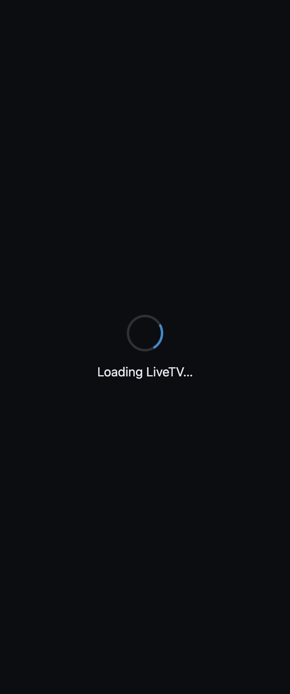
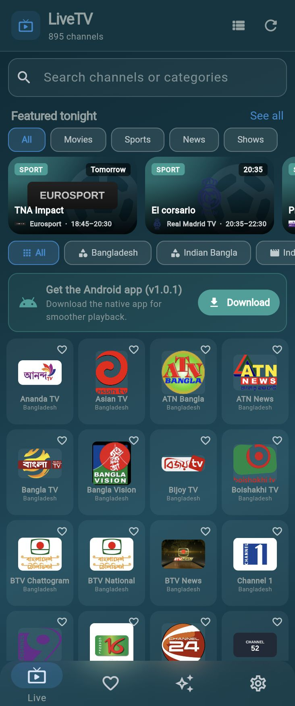

# LiveTV

[](https://flutter.dev)
[](https://dart.dev)
[](LICENSE)
[]()

A Flutter IPTV player that loads the
[BDIX-IPTV International playlist](https://github.com/saeidrahmanbd/BDIX-IPTV)
on launch and plays channels inside the app. Runs on Android, iOS, macOS and the
web.

## Screenshots

> Screenshots captured from the running web build. Add more (e.g.
> `settings.jpg`) to `docs/screenshots/` to extend this gallery.

| Home | Watch |
|------|-------|
|  |  |

## Features

- **Auto-loads** the playlist from GitHub on first start and caches it, so the
  channel list opens instantly next time and still works offline.
- Refreshes automatically when the cached copy is more than 15 minutes old, and
  offers pull-to-refresh everywhere.
- **3,000+ channels** in the playlist's own categories, with logos, search and a
  favourites list.
- **In-app playback** with `media_kit` (libmpv): HLS (`.m3u8`), raw MPEG-TS
  (`.ts`), DASH (`.mpd`) and `.flv` streams.
- Player controls: play/pause, mute, previous/next channel, reload, copy stream
  URL, favourite, buffering indicator and a readable error screen with retry.
- **Adult section hidden by default.** Enable it in Settings after a
  confirmation.
- **TV guide (EPG)** downloadable on demand (~69 MB) — now/next info on the
  watch screen and a full browsable guide.
- **Featured rail** of live and upcoming movies, sports, news and shows.
- **Deep links / sharing** — every playing channel gets a shareable `/#/watch/<id>`
  URL; refresh or open it to land on that channel.
- **Web build** with a responsive desktop layout, immersive watch page and
  mixed-content handling.
- Dark UI, landscape player, keeps the screen awake, immersive mode.

## Admin panel

The playlist can be managed at <https://liveiptvbd.netlify.app>. The app reads its
remote config from `/.netlify/functions/config` on that site (see
`AppConfig.configUrl`).

## Requirements

- Flutter 3.47 or newer (Dart 3.13+)
- Android SDK (API 21+) and/or Xcode for iOS / macOS
- A modern browser for the web build

## Run

```bash
flutter pub get
flutter run
```

Build a release APK:

```bash
flutter build apk --release
```

The output is `build/app/outputs/flutter-apk/app-release.apk`.

Build for the web (hostable on Netlify or any static host):

```bash
flutter build web --release
```

Output is `build/web`. The included `netlify.toml` uses this command and publishes
`build/web`. Netlify's default build image does not include Flutter, so either
enable a Flutter build plugin on the site or build in CI and deploy `build/web`
(e.g. via the Netlify CLI). Plain `http://` streams are blocked by browsers on
an `https://` site, so the web build shows an "Open stream" prompt
for those channels instead of playing them in-page.

## Structure

```text
lib/
  core/                 constants, theme, small helpers (deep links, open URL)
  data/
    models/             Channel, PlaylistState
    m3u_parser.dart     dependency-free EXTINF parser (runs on an isolate)
    playlist_repository.dart  download + Hive cache
    hive_store.dart     box names/accessors
  providers/            Riverpod providers (settings, favourites, playlist, player)
  screens/              home, favourites, featured, settings, player, root shell
  widgets/              channel card/grid/tile, featured rail, loading/error states
```

The playlist is cached as raw text in Hive and parsed with `compute()` in a
background isolate. The parser and its tests are pure Dart, so they run without
any platform setup.

## Architecture notes

- State management: **Riverpod** (`StateNotifierProvider` for the player,
  `FutureProvider`/`AsyncNotifier` for playlist & EPG).
- Storage: **Hive** (playlist, parsed cache, favourites, EPG, settings).
- Playback: **media_kit** (libmpv) with a shared `Player`/`VideoController`
  owned by `PlayerNotifier`; the watch screen and desktop shell both drive the
  same instance to avoid overlapping audio.
- Web specifics: hash-based deep links, responsive desktop shell (≥ 900 px),
  mixed-content detection, and an immersive `PlayerScreen` route instead of
  native fullscreen.

## Notes and limitations

- 1,049 of the playlist's stream URLs are plain `http://`. The app allows
  cleartext traffic on Android and iOS so those channels can play. Without the
  exceptions in `AndroidManifest.xml` / `Info.plist`, roughly a third of the
  channels would fail silently.
- The playlist is BDIX-oriented, so many streams may only be reachable from
  networks in Bangladesh. Dead or geo-blocked channels show an error with
  **Retry** and **Next channel** instead of hanging forever.
- The TV guide (EPG) can be downloaded on demand from Settings (about 69 MB).
  It provides now/next info on the watch screen and a full browsable guide.
- This app ships no streams. It only plays the third-party playlist and caches
  its public URL; all channel availability and content remain the playlist
  author's responsibility.

## Tests

```bash
flutter test
flutter analyze
```

## Contributing

1. Fork the repo and create a feature branch.
2. Run `flutter analyze` and `flutter test` before opening a PR.
3. Keep changes focused; match the existing style (Riverpod providers, Hive
   cache, `compute()` for heavy parsing).

## License

MIT — see [LICENSE](LICENSE).